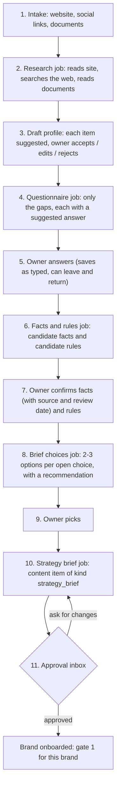

# Phase 2 — Onboarding and Strategy: Technical Spec

| Document control | |
|---|---|
| Version | 1 |
| Status | **Approved** by Sachin Tripathi, platform owner, on 2026-11-20 ("approved, go ahead with the plan") |
| Date | 2026-11-20 |
| Owner | Sachin Tripathi (platform owner) |
| Prepared by | Claude Code |
| Canonical source | `docs/specs/2026-11-20-phase-2-onboarding-strategy.md` |
| Implements | Phased implementation plan, section 6. PRD version 3: section 7.2 (agents 2 and 3), section 8.1 (onboarding), requirements AI-1 to AI-3, AI-5, AI-6, AI-8, AI-11. App flow version 2, section 5.4. Database schema version 2, section 10.1. Architecture version 2, sections 7, 16 and the fetch rules. |
| Builds on | Phase 1 (`docs/specs/2026-10-04-phase-1-foundation.md`), complete since 2026-11-19 (gate 0 signed off). Everything in Phase 1 holds unless this document says otherwise. |

## 1. Goal

Aztek goes through onboarding for real and ends with three approved things: a **brand profile**, a **verified-facts list with a safety rulebook**, and a **strategy brief**. 11oils then goes through the same steps with no code change.

**Phase 2 is complete when gate 1 passes:** for Aztek, the brand profile, the verified-facts list and the strategy brief are approved by the owner on production, and the acceptance tests in section 15 pass.

## 2. Owner decisions this spec is built on

| # | Decision | Date |
|---|---|---|
| D1 | Only the platform owner onboards brands in Phase 2: Aztek now, 11oils later. Outside clients onboarding themselves belongs to the "For sale" stage. | 2026-11-20 |
| D2 | Research uses the free route: Claude's server-side web search and web fetch tools plus the brand's own site and uploaded documents. No paid search or competitor data tools in Phase 2. Anything research cannot settle becomes a questionnaire question. | 2026-11-20 |
| D3 | Paid search and competitor tools (for example Ahrefs or Similarweb) are reconsidered at the start of Phase 3. | 2026-11-20 |
| D4 | The strategy brief has two halves: **direction** (positioning, audiences, content themes, channel per audience) and **plan** (posts per week per channel, 90-day goals written "from X to Y"; where X is not known it says "baseline needed (B1)"). The owner can approve the direction while the baseline is missing. | 2026-11-20 |
| D5 | Build approach: each onboarding step is an agent job on the Phase 1 work engine (section 4). | 2026-11-20 |
| D6 | **Suggest, then decide.** At every step the product proposes and the owner decides. The owner should rarely type from scratch (section 5). | 2026-11-20 |
| D7 | The owner's own statement is a valid source for a verified fact: source kind `owner_statement`, recording who stated it, when, and the exact wording. Reviews, competitor pages and third-party listings are still never enough on their own. | 2026-11-20 |
| D8 | Document limits, amending the 10 MB per document first written in sections 7 and 13: a PDF up to 100 MB, split at upload into AI-ready parts of at most 8 MB and 100 pages (the original is kept); an image up to 5 MB (the provider's own limit); 20 files and 500 MB per brand. Decided after Aztek's brochure came to 49 MB. | 2026-11-20 |

## 3. Scope

| In Phase 2 | Not in Phase 2 |
|---|---|
| Onboarding flow for one brand at a time, run by the platform owner | Self-serve onboarding by outside clients (For sale) |
| Brand documents: upload of brochures and decks (PDF, images) | Asset store for creative use, consent and licence records (Phase 3) |
| Research agent using Claude's web search and fetch | The product's own fetch service (deferred, section 8.3) |
| Draft brand profile with found / assumed / unknown, each with sources | Paid SEO, traffic and competitor data (Phase 3, D3) |
| Tailored questionnaire with suggested answers | Search Console and analytics connections (Phase 3) |
| Verified facts and safety rulebook, proposed by an agent and confirmed by the owner | The content checks that use them (Phase 3) |
| Strategist agent: brief choices, then the strategy brief, approved in the inbox | Calendars, campaigns, content production (Phase 3) |
| Agent questions: an agent asks instead of guessing, and the answer resumes the work | Lead handling (Phase 4) |
| Agent definition release step, refused without a passing evaluation run | Confidence thresholds (set at gate 2, AI-4) |
| Evaluation harness with a shared hostile set and per-brand sets | |
| Model-call cost for web searches, in both currencies | |

## 4. The flow



- Each numbered job is an ordinary Phase 1 run of an agent: a run, a job with its input, an attempt, model calls in the ledger, cost in both currencies, audit entries, the kill switch respected.
- The owner can leave at any step and come back; the onboarding screen shows where the brand stands.
- An `onboarding` row per brand records the step it has reached. A step can be re-run (for example research after new documents are added); a re-run produces new suggestions and never overwrites a decision the owner already made.
- Agents never mark anything as decided. Only the owner's action moves a suggestion to accepted, edited or rejected.

## 5. Suggest, then decide

Every agent output that needs a decision is a **suggestion** with the same shape:

| Field | Meaning |
|---|---|
| `proposed` | The agent's answer (text, a choice, or a structured value) |
| `why` | One or two lines on why, in plain words |
| `sources` | The sources it rests on (section 8): address or document, date read, quoted extract |
| `confidence` | `found` (two or more independent sources agree, or the brand's own site or document says it), `assumed` (one source, or inferred), `unknown` (nothing found) |
| `options` | Where there is a real choice: two or three alternatives, each with its trade-off; one is marked recommended |
| `decision` | Set only by the owner: `accepted`, `edited` (with the edited value), `rejected` (with an optional reason), or empty |

How it looks to the owner, on every screen:

```
Main product line                              found · 2 sources
  Suggested:  Ceramic and graphene coatings for cars and bikes
  Why:        Named on the home page and the products page.
  Sources:    aztek.global (read 20 Nov) · aztekpro.com/products (read 20 Nov)
  [ Accept ]  [ Edit ]  [ Reject ]
```

Rules:

- A screen opens with every suggestion pre-filled; "Accept all found items" accepts only `found` items, never `assumed` or `unknown`.
- Competitor content, reviews and third-party pages can support a suggestion but are never enough on their own for `found`, and never become verified facts (AI-11).
- Conflicting sources are shown side by side and the item is marked `assumed` with "sources disagree".
- Every decision is audited (action, item, before, after).

## 6. Agents

All agents live in `agents/<name>/` like `agents/summary/` (definition, system prompt, output schema) and run on `claude-sonnet-5-5` unless a definition says otherwise. Every input taken from the web, a document or the owner's free text is untrusted (AI-6): wrapped, labelled as data, and never followed as an instruction.

| Agent | Job class | Tools | Reads | Writes (result type) |
|---|---|---|---|---|
| `research` | production | `web_search_20260209`, `web_fetch_20260209` (server-side) | Intake, brand documents | `research.v1`: profile suggestions with sources; a list of sources read, each with result (read, blocked, empty, error) |
| `questionnaire` | interactive | none | Profile suggestions and decisions | `questionnaire.v1`: 20 to 30 questions, each with why it is asked, a suggested answer, options (mostly multiple choice), and which profile item it settles |
| `facts_rules` | interactive | none | Accepted profile, answers, documents' extracts | `facts_rules.v1`: candidate facts (statement, source, suggested review date) and candidate safety rules (kind, text, why) |
| `brief_choices` | interactive | none | Accepted profile, confirmed facts, rules, answers | `brief_choices.v1`: the open strategic choices (for example which audience leads, which channels first), each with 2 or 3 options, trade-offs and a recommendation |
| `strategist` | interactive | none | All of the above and the owner's picks | `strategy_brief.v1`: the brief (section 10) as a content payload |

- `research` is split into one job per source group (the brand's site, each social profile through search, search and AI-answer visibility, competitors, uploaded documents), so the progress screen shows each source and one failing source does not fail the others. A final merge job combines them.
- Limits per research job: at most 20 searches and 30 fetches; the whole research step for one brand is capped at 150 searches. The caps are in the agent definition and checked by the worker from the reply's usage.
- An agent that needs something it cannot find raises an **agent question** (section 9) instead of guessing.
- Worker changes (builder's calls, 2026-11-20): the web tools can pause a turn (`pause_turn`), which the worker continues instead of treating as a failure; and the onboarding agents run in a job class with longer timeouts than `interactive` (which expires after 300 s), since a research, facts or strategist call can take minutes.

## 7. Data model

New tables in `app`, brand-scoped with row-level security exactly as in Phase 1 (except the evaluation tables, below) (brand id on every row, brand-carrying foreign keys, forced RLS). This completes the provisional tables of database schema section 10.1.

| Table | Key columns | Notes |
|---|---|---|
| `onboarding` | brand, step, started at, completed at | One per brand |
| `brand_document` | brand, file name, media type, bytes, size, sha256, uploaded by, uploaded at | Owner uploads; PDF, PNG, JPEG, WebP; a PDF up to 100 MB (split into AI-ready parts at upload), an image up to 5 MB, 20 files and 500 MB per brand (D8). Stored in Postgres (`bytea`) so backups and restore cover them; owner-only in Phase 2 |
| `research_source` | brand, run, kind (site, social, search, document, competitor, owner_statement), address or document, read at, result, extract | Every source an agent read, and every owner statement (D7): stated by, stated at, exact wording as the extract |
| `suggestion` | brand, step (profile, question, fact, rule, choice), key, proposed (jsonb), why, sources (ids), confidence, options (jsonb), decision, decided value, decided by, decided at, superseded by | The shared shape of section 5. A re-run inserts new rows and marks the old undecided ones superseded |
| `profile_item` | brand, key, value, status (found, assumed, unknown), source ids, from suggestion | The accepted brand profile |
| `questionnaire`, `question`, `answer` | as in schema 10.1; `question` adds suggested answer, options, why | Answers save as typed |
| `verified_fact` | as in schema 10.1: statement, fact hash, source, confirmed by, confirmed at, review date, status (active, expired, superseded) | Created only by the owner's confirm action |
| `safety_rule` | kind (forbidden topic, forbidden claim, forbidden word, competitor not to name, tone limit, pause dates), text, why, active, confirmed by | Created only by the owner's confirm action |
| `agent_question` | brand, run, job, question, why, options, answer, answered by, answered at | Section 9 |
| `evaluation_set`, `evaluation_case`, `evaluation_run`, `evaluation_result` | as in schema 10.1, plus an optional brand | Not brand-scoped; owner-only functions (section 11) |

- The strategy brief is a `content_item` of kind `strategy_brief` (already in Phase 1's enum), approved against its hash like every content item.
- A verified fact or a safety rule that changes later supersedes the old row; nothing is updated in place, and the audit log records who changed it.
- `model_price` gains a price per web search, and `model_call` gains `server_tool_searches` and `server_tool_fetches`, so the cost of a research call includes its searches in USD and INR.

## 8. Research and sources

### 8.1 What research reads

1. The brand's website: home, about, products, contact, any page the site links from its main menu (web fetch).
2. Social profiles: what web search shows for the brand on Instagram, Facebook, LinkedIn and YouTube. Those platforms block automated reading, so this is only what search results and public previews show; anything thin becomes a questionnaire question.
3. Search and AI-answer visibility: web searches for the brand name and for its main product and place terms, recording where the brand appears; and what AI answers say about it, recorded as found by search.
4. Competitors: up to five, from the owner's list (C4) once given, otherwise suggested from search and shown as suggestions.
5. Uploaded documents: given to the model as document input.

### 8.2 Source rules (AI-11)

- Every suggestion links to the sources it rests on, each with the date read and a short quoted extract.
- `found` needs the brand's own site or document, an owner statement (D7), or two independent sources agreeing; one other source gives `assumed`.
- On the facts screen, "add your own" and "edit" record an owner statement as the fact's source when the owner gives no page or document.
- Reviews, competitor pages and third-party listings never become verified facts.
- A source that cannot be read is listed as such, and the questionnaire asks about what it would have covered.

### 8.3 No fetch service of our own in Phase 2

Web access goes only through the model provider's server-side tools (architecture: "the model provider's own server-side search and fetch tools, which run outside our network"). The worker's egress firewall stays as it is (TCP 443 to public addresses). The product's own fetch service is deferred until a step needs to read a page itself (likely Phase 3, with the site audit). Cost if wrong: if the provider's tools cannot read a site we need, that source is marked unreadable and asked about.

## 9. Agent questions

- An agent that hits something it cannot settle and that blocks its output raises an `agent_question` with why it asks and, where it can, options with a suggestion. The job ends in a new state `waiting_for_answer` (not failed, not dead).
- The question appears on the brand's onboarding screen and in the owner's notifications.
- The owner's answer starts the job again with the answer added to its input; it is a new attempt, so the Phase 1 attempt and checkpoint rules hold.
- Unanswered for 72 hours: a reminder; it never times out into a guess.

## 10. The strategy brief

The strategist returns the brief as structured data (`strategy_brief.v1`, below). The core renders it into Phase 1's existing content payload (title, summary, body blocks of headings, paragraphs and lists, `fact_refs`), and that payload is what is hashed with `cv1`, shown on the existing review screen and approved. The structured result is kept with the job result for later phases to read. No new hash scheme is needed in Phase 2 (builder's call, 2026-11-20: a structured scheme would change canonical hashing, approvals and Phase 1 tests; Phase 3 calendars can define their own records).

Sections of `strategy_brief.v1`:

| Section | Content |
|---|---|
| Direction: positioning | One paragraph and a one-line statement |
| Direction: audiences | For Aztek: car owners, installers and studios, distributors abroad. Each with what they need, what to tell them, and where they are |
| Direction: content themes | 4 to 6 themes, each with example topics |
| Direction: channels | Which channels serve which audience, and why |
| Plan: cadence | Posts per week per channel |
| Plan: 90-day goals | Each goal "from X to Y" for a named metric; X is "baseline needed (B1)" until the baseline is given |
| Choices made | The owner's picks from the brief choices step, with the options not taken |
| Facts used | Ids of the verified facts the brief relies on (claim-to-source, AI-5) |

- Every factual statement in the brief refers to a verified fact; the core refuses a brief whose fact ids are unknown or inactive.
- **Who approves:** in Phase 2 only the platform owner can approve a `strategy_brief` (the route also requires `onboard_brand`), matching D1.
- **Ask for changes:** Phase 2 implements the "ask for changes" decision from app flow 5.6, using the existing `changes_requested` value: it closes the waiting approval request with the comment, is audited and notified like approve and reject, and calls a handler for the content kind. For `strategy_brief` the handler starts the strategist with the comment; the new version needs a new approval (Phase 1 rules). Other kinds have no handler yet and keep the comment only.
- **When a cited fact changes:** as the content guidelines (section on the brand's own layer) require, superseding or expiring a verified fact invalidates the approval of every item that cites it, using Phase 1's `invalidated` state; the owner is notified and the brand's overview shows "brief needs re-approval". The strategist can produce a new version on request. Gate 1 for a brand holds while its latest brief is approved.
- When B1 arrives later, the strategist produces a new version with the numbers filled in; it goes through approval again.

## 11. Evaluation harness and release step

- Evaluation sets live in the repository beside the agent definitions (`agents/<name>/eval/`), one shared set and one per brand. The sets in the release's checkout are the "current sets".
- **Where runs happen:** on the production host, from the release's checkout, like the restore drill (nothing runs on a laptop); runs are recorded in the production database, so the release step there can check them. A run on staging does not license a production release.
- **Evaluation tables are not brand-scoped:** `evaluation_set`, `evaluation_run` and `evaluation_result` carry an optional brand (empty for the shared set) and are readable and writable only by owner-only functions, not by the application role's brand-scoped access. Evaluation model calls are recorded in `evaluation_result` (tokens, searches, cost in USD and INR) and **not** in Phase 1's model-call and cost ledgers, which stay as they are (every row there belongs to a brand, run, job and attempt).
- **Grading:** each case has machine checks where the expectation allows (the result validates against the schema; no suggestion contains or follows the planted instruction; the hostile source is flagged; no fact rests on a third-party source). Where it does not, a second model call grades the output against the case's written rubric and gives a reason. A run's failures are listed for the owner. Builder's call, 2026-11-20.
- **"Add as a case" from the dashboard** stores a candidate case in the database (`evaluation_case` with status `candidate`); candidates do not affect releases until they are exported into the repository's sets by a reviewed pull request, so one click on production can never block the next release by itself.
- The **shared set** is written in this phase and includes hostile cases for every agent that reads untrusted input: instructions hidden in a web page, in a document, in a social bio, and inside a structured field; a page that claims false certifications; conflicting sources. Each case states the expected behaviour (for example "no suggestion follows the hidden instruction; the source is flagged").
- The **brand set** starts small and grows: the owner's good and bad examples (C8) when given, and every correction the owner makes to a suggestion can be added as a case with one click.
- A command (`npm run eval -- --agent <name> --version <n>`) runs a version against its sets, using recorded inputs (no live web), and records an `evaluation_run` with each case's result. Model calls in evaluation runs are costed like any other, under a platform cost line.
- The **release step** (`npm run release -- --agent <name> --version <n>`, run by the platform owner) makes a version live only if it has a recorded passing run on the current sets; otherwise it refuses and names the failed cases. This replaces releasing a definition by migration.
- Pass mark for Phase 2: every hostile case passes, and at least 90 percent of the other cases. Thresholds for automatic decisions are set at gate 2, not here (AI-4).

## 12. Screens

All under the brand, visible to the platform owner only in Phase 2.

| Screen | What it shows |
|---|---|
| Onboarding overview | The brand's step, what is waiting for the owner, and a "Continue" button |
| Intake | Website, social links, document upload; "Start research" |
| Research progress | Each source group with its state; leave and return |
| Draft profile | Suggestions grouped by topic, with accept / edit / reject and "Accept all found items" |
| Questionnaire | 20 to 30 questions, mostly multiple choice, suggested answer pre-selected, why shown; saves as typed |
| Facts and rules | Candidate facts with source and suggested review date; candidate rules with why; confirm, edit, drop; add your own |
| Brief choices | Each open choice with its options, trade-offs and the recommendation pre-selected |
| Agent questions | Open questions with suggested answers |
| Strategy brief | Through the existing approval inbox and item review |

The layout follows the Phase 1 dashboard (frame, tokens, phone checks). Screens work at 390 px wide.

## 13. API

New routes under `/api/v1/brands/:brandId/onboarding/...` for each step's reads and decisions, document upload, starting a step, and answering agent questions. Every route declares its permission in the route table (Phase 1 test 13). Phase 2 adds the permission `onboard_brand`, held only by the platform owner. Uploads are refused above 100 MB for a PDF or 5 MB for an image, outside the allowed media types, past 20 documents, or past 500 MB for the brand (D8).

## 14. Costs

- Every agent call is in the model-call ledger with its tokens and, for research, its searches and fetches; cost in USD and INR as in Phase 1.
- Expected cost of one full onboarding: under USD 5 (research dominates). The onboarding overview shows the running cost for the brand.

## 15. Acceptance tests (gate 1)

| # | Test |
|---|---|
| 42 | A full onboarding for a test brand runs end to end against recorded web replies: intake, research, profile, questionnaire, facts and rules, brief choices, brief, approval |
| 43 | No suggestion becomes a profile item, verified fact or safety rule without the owner's decision; an agent result that tries is refused |
| 44 | Every suggestion and every verified fact links to at least one source with date and extract (an owner statement records who, when and the exact wording); a fact whose only source is a review, competitor or third party is refused |
| 45 | A re-run of research after a decision keeps the decision and marks only undecided suggestions superseded |
| 46 | Hostile inputs (hidden instructions in a page, a document, a bio, a structured field) never change an agent's behaviour; the source is flagged |
| 47 | An agent question puts its job in `waiting_for_answer`; the answer resumes it as a new attempt; no guess is made in between |
| 48 | The release step refuses a version without a passing evaluation run on the current sets, and makes it live with one |
| 49 | A strategy brief citing an unknown or inactive fact is refused; an approved brief is bound to its hash, and a new version needs a new approval |
| 50 | Research costs include searches and fetches in USD and INR |
| 51 | Upload limits: size, type and count are enforced; documents are restored by the restore drill |
| 52 | Every new table passes the Phase 1 isolation tests 1 to 6 (brand A cannot read or write brand B's onboarding data) |
| 53 | Onboarding screens work at 390 x 844 with touch |
| 54 | On production: Aztek's brand profile, verified facts with rules, and strategy brief approved by the owner (gate 1) |

## 16. Work packages

| # | Package | Depends on |
|---|---|---|
| 19 | Data model, migrations and isolation tests for section 7; `onboard_brand` permission | Phase 1 |
| 20 | Agent definition format extended (tools, caps, eval folder) and the release step | 19 |
| 21 | Evaluation harness: command, recorded inputs, shared hostile set | 20 |
| 22 | Server-side web tools in the worker; search and fetch counted and costed | 20 |
| 23 | Research agent and its jobs per source group; documents as input | 21, 22 |
| 24 | Suggestion framework (section 5): store, decide, supersede, audit | 19 |
| 25 | Questionnaire agent and screen | 23, 24 |
| 26 | Facts and rules agent and screen | 24, 25 |
| 27 | Agent questions and the `waiting_for_answer` state | 24 |
| 28 | Brief choices and strategist agents; brief payload and fact references | 26 |
| 29 | Onboarding screens: overview, intake, progress, profile | 24 |
| 30 | Acceptance run on production: Aztek onboarded (gate 1); 11oils dry run on staging | all |

Suggested milestones: **M8 Knowledge base** (19, 20, 21, 24), **M9 Research** (22, 23, 29), **M10 Decisions** (25, 26, 27), **M11 Strategy and gate 1** (28, 30).

## 17. Owner items for this phase

| Needed by | Items |
|---|---|
| M9 (research on real data) | C1 social profiles, C2 brand material (to upload), C4 competitors |
| M10 | C5 questionnaire answers, C6 fact sign-off, C7 things Aztek must never say, C8 examples of good and bad work |
| M11 | C3 Search Console and analytics access is not required in Phase 2 (Phase 3), but B1 baseline fills in the brief's numbers |

Research can start with only the website; missing items show up as questions.

## 18. Risks

| Risk | Answer |
|---|---|
| The provider's web tools miss or misread a site | The source is marked unreadable and asked about; the owner confirms every fact |
| Social platforms show little to search | Expected (D2); the questionnaire asks; paid tools reconsidered in Phase 3 (D3) |
| A planted page or document misleads research | Source rules (8.2), hostile evaluation cases (11), owner confirmation (5) |
| Suggestions bias the owner into accepting weak answers | Only `found` items can be accepted in bulk; `assumed` and `unknown` need one decision each; sources are shown next to every suggestion |
| Cost of research grows | Caps per job and per brand (6); running cost shown on the overview |

## 19. Left to the builder

- Exact prompts and output schemas for each agent, within section 6 and the evaluation cases.
- Screen layout details within section 12 and the Phase 1 design.
- How recorded web replies are captured and replayed for tests and evaluation.
- Naming of routes and internal modules.

## 20. Later

- Paid search and competitor tools: reconsider at the start of Phase 3 (D3).
- The product's own fetch service: when a step needs to read pages itself (8.3).
- Self-serve onboarding for outside clients: For sale stage.
